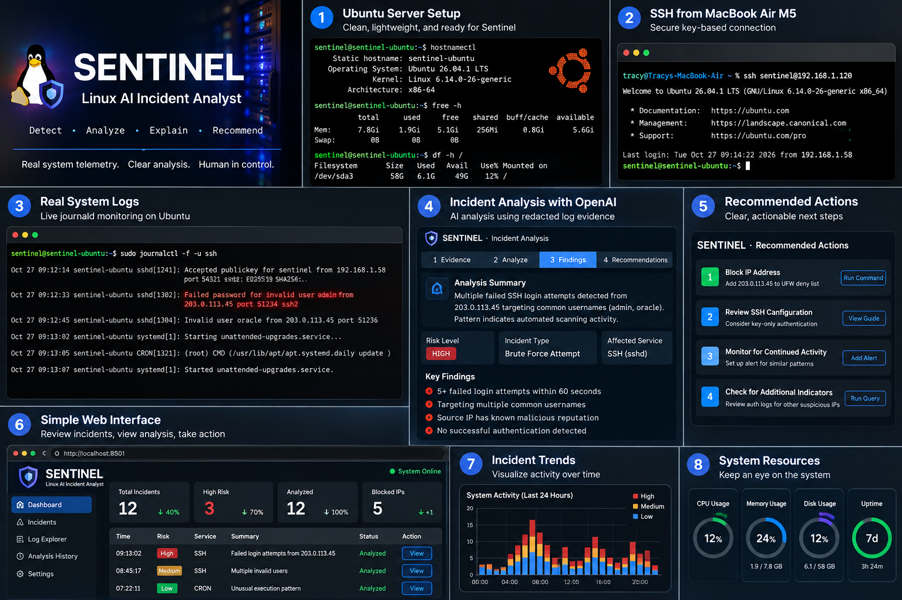
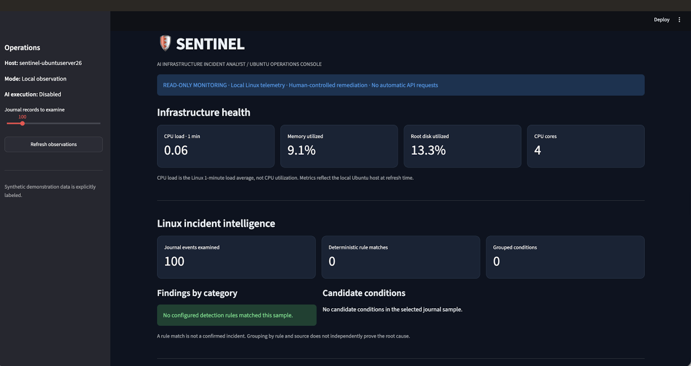
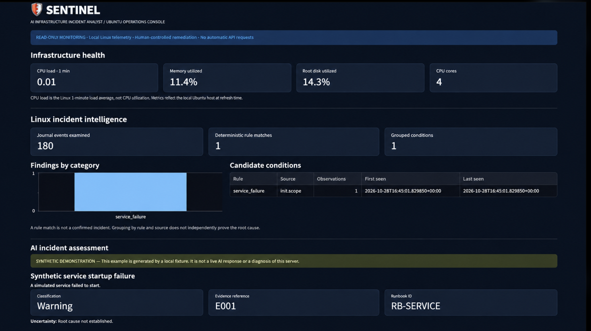
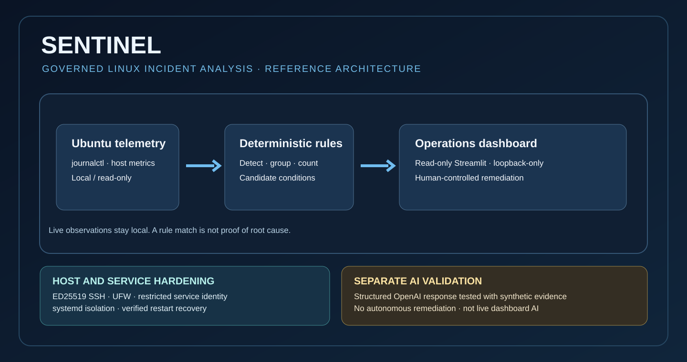
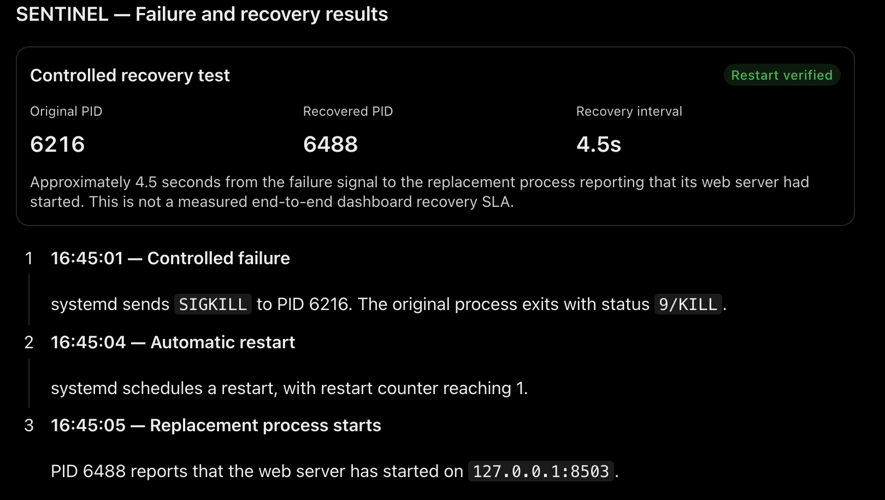

# SENTINEL

**Governed AI-Assisted Linux Incident Analysis**

A working Ubuntu reference implementation combining local telemetry, deterministic detection, validated AI assessment, host hardening, and a least-privilege Streamlit dashboard with verified restart recovery.

> **Scope:** This is a tested reference implementation, not a production-hardened fleet service. Dashboard observations are real local Ubuntu telemetry. The AI assessment **displayed in the dashboard is a labeled synthetic fixture**, not an automatic live diagnosis. A separate OpenAI adapter successfully made one live API request using synthetic evidence.

## Project visual — concept illustration



*Original concept artwork. This is an illustrative product vision, **not** a screenshot of the implemented dashboard, a verified incident, or an autonomous remediation capability.*

## Real operations console



*Authentic SENTINEL Ubuntu operations console. Local telemetry and journal observations are read-only; zero rule matches in a selected sample do not indicate a detector failure.*

## Additional SENTINEL view



*Updated project visual supplied for the README. Consult the live dashboard and verified test results below for the scope of implemented functionality; this image is not independent proof of automated remediation or model diagnosis.*

## Architecture and security boundaries



**Telemetry → deterministic rule detection → candidate-condition grouping → read-only dashboard.** SSH hardening, UFW, a non-sudo service identity, and restricted systemd runtime protect the Ubuntu host. The AI integration is separate and default-disabled in the dashboard. A rule match does not establish root cause or authorize remediation.

## Detection and AI assessment evidence

In the verified October 2026 local test, the dashboard examined **180 journal events**, produced **one service-failure rule match** and **one grouped candidate condition**. Its AI incident assessment panel used an **explicitly labeled synthetic fixture** with evidence reference `E001`, approved runbook `RB-SERVICE`, and an explicit statement that root cause was unknown. This is not a live model diagnosis of the Ubuntu host.

## Controlled recovery — visual summary



*Presentation summary based on recorded systemd events; not a raw journal screenshot. A deliberate SIGKILL ended PID `6216`, systemd restarted the service, and PID `6488` served HTTP 200. The approximately 4.5-second interval shown is process-to-web-server-start evidence, **not** an end-to-end recovery SLA.*

## Additional project visual


*Supplementary presentation visual; the documented tests below are the evidence for actual system behavior.*

## Verified engineering results — October 28, 2026

| Control | Observed evidence |
|---|---|
| Automated tests | **29 passed** via `python -m unittest discover -s tests -v` |
| Model integration | One successful live OpenAI API request with **synthetic** service-failure evidence, validated against a structured schema |
| SSH | ED25519 key-only login succeeded; password-only login rejected; effective root SSH login prohibited |
| Network | UFW active; deny incoming, allow outgoing; SSH TCP/22 allowed from trusted `192.168.1.0/24` LAN |
| Privacy boundary | Dashboard bound to `127.0.0.1` and accessed through SSH forwarding; no OpenAI key copied into restricted dashboard deployment |
| Service identity | Dedicated `sentinel` account, `/usr/sbin/nologin`, no sudo; `systemd-journal` membership permits journal reading |
| Isolated runtime | Root-owned source in `/opt/sentinel`; independent Python 3.14.4 environment with Streamlit 1.66.1 |
| Health | `sentinel-test.service` active, HTTP **200** at `127.0.0.1:8503/_stcore/health` |
| Recovery | Intentional SIGKILL terminated PID **6216** at 16:45:01 UTC; systemd restarted once; replacement PID **6488** began listening at 16:45:05 UTC; post-restart `active`, `NRestarts=1`, HTTP **200** |
| Preservation | Original dashboard remained listening on localhost port `8501` during the restricted-service recovery test |

**Recovery measurement:** Approximately 4.5 seconds elapsed between the failure signal and the replacement web server's startup log; this is not an end-to-end availability SLA.

## Reproduce the development dashboard

On a Linux host with appropriate journal permissions:

```bash
python3 -m venv .venv
source .venv/bin/activate
python -m pip install 'streamlit==1.66.1'
python -m unittest discover -s tests -v
python -m streamlit run app.py --server.address 127.0.0.1 --server.port 8501 --server.headless true
```

From a separate workstation:

```bash
ssh -N -L 8502:127.0.0.1:8501 YOUR_USER@YOUR_HOST
```

Then open `http://127.0.0.1:8502` in a browser. The service unit in [docs/deployment/sentinel-test.service](docs/deployment/sentinel-test.service) documents the separate restricted test deployment; it assumes prior provisioning of `/opt/sentinel`, its Python environment, and the `sentinel` identity. It is **not automatically installed** by the repository.

## Verify the systemd recovery evidence

```bash
systemctl show sentinel-test.service -p User -p Group -p MainPID -p NRestarts
curl --max-time 5 -sS -o /dev/null -w 'HTTP %{http_code}\n' http://127.0.0.1:8503/_stcore/health
sudo journalctl -u sentinel-test.service -n 20 --no-pager
```

These commands inspect a correctly provisioned local installation; they do not install the service or trigger another failure.

## Boundaries and limitations

- Read-only dashboard: no autonomous remediation or automatic OpenAI requests.
- The displayed AI panel uses synthetic data. A separate live model call used **synthetic evidence only**, not real system logs.
- Schema validation does not establish factual correctness or root cause.
- Regular-expression redaction reduces exposure but does not guarantee full removal of sensitive data.
- Membership in `systemd-journal` allows broad system journal access; fine-grained source isolation has not been demonstrated.
- Isolated service was started manually, named `sentinel-test.service`, and **was not enabled on boot**.
- No full-reboot, fleet-scale, load, adversarial, enterprise identity, or end-to-end availability validation was performed.
- Host had pending Ubuntu updates during testing.
- Screenshots capture a point-in-time VM demonstration, not a production SLA.

## Engineering principle

> **Capability is not authority.** Observation, structured interpretation, human authorization, and execution must remain separate.

**Build it. Secure it. Test it. Prove it.**
